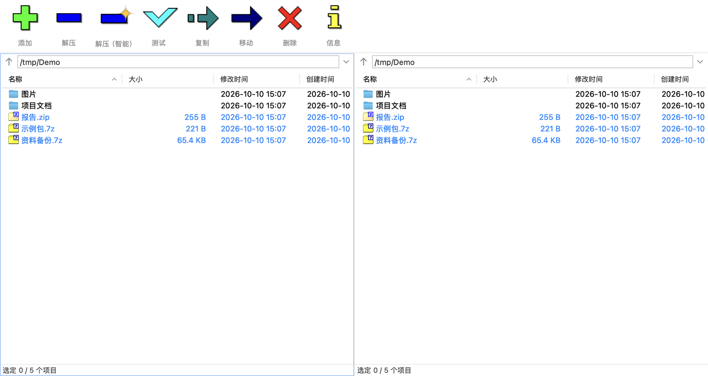
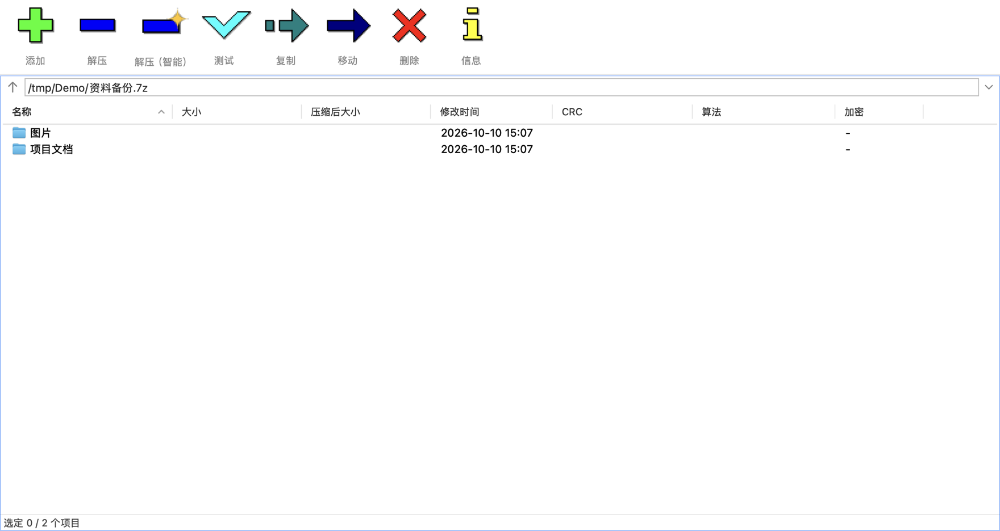

# 7-Zip File Manager for macOS

**English** | [简体中文](README.zh-CN.md)

A minimal macOS 7-Zip client.

A native AppKit GUI frontend for the 7-Zip engine on macOS, reusing the official `7zz` engine;  
the GUI and interaction replicate the official Windows 7-Zip File Manager.

Upstream 7-Zip ships only a command-line tool (`7zz`) on macOS. This project wraps the same  
engine in a native AppKit interface, following the interaction model of the Windows 7-Zip  
File Manager — the toolbar layout and the function keys (`F3`, `F4`, …) match it.  
"Extract Smart" is a macOS-only addition; see below.


## Features

**Formats** — everything the 7-Zip engine supports: 7z, zip, rar, tar, gz, bz2, xz, zst, iso,  
dmg, cab, rpm, deb, apk, ipa, msi, docx, xlsx, and more.

**Extract** — Extract Here / Extract To… / Extract Smart (decides whether to add a wrapping  
folder from the archive's top-level layout); extract individual entries while browsing an  
archive.

**Create** — 8 formats: 7z, zip, tar, xz, gzip, bzip2, wim, and checksum (hash) files. The  
parameters panel covers compression level, method, dictionary size, word size, solid block  
size, thread count, volume size, AES-256 encryption, and filename encryption. Dragging files  
or folders in from Finder opens the same panel.

**Browse** — double-click to enter an archive and navigate it like an ordinary directory  
(enter/leave, sort, inspect properties). Dual-panel mode; `F9` toggles single/dual panel.

**File operations and checksums** — rename, copy, move, delete, new folder/file, select by  
mask; test a whole archive; CRC32, CRC64, SHA-1, SHA-256, BLAKE2sp and other checksums; file  
comparison; split and combine.

**System integration** — 5 Finder services (Extract Smart, Extract Here, Extract To…, Add to  
Archive…, Test Archive); dropping items onto the window creates an archive, `⌘`-drop copies  
instead; archive types are registered as an alternate handler, so your current default  
application is left untouched.

## Screenshots

| Dual panel | Inside an archive |
| ---------- | ----------------- |
|  |  |


## Requirements

- macOS 13.0 or later.

## Installation

1. Download the 26.03 DMG from  
   [Releases](https://github.com/Tom13908/7-Zip-File-Manager-for-macOS/releases) and mount it.
2. Drag `7-Zip File Manager` into `Applications`.
3. The first launch is blocked by Gatekeeper; see below.
4. Enable the Finder services in System Settings (see "Finder services").

The engine ships inside the app (`Contents/Resources/7zz`); no separate 7-Zip install is needed.

### First launch

The app is not notarized by Apple, so Gatekeeper blocks it the first time.

- **macOS 15 and later**: dismiss the "Apple could not verify…" prompt, then open  
  `System Settings → Privacy & Security`, scroll to the Security section, click "Open Anyway"  
  and confirm once more.
- **macOS 13 / 14**: right-click the icon, choose "Open", and confirm in the dialog.

Or remove the quarantine attribute directly:

```
xattr -cr "/Applications/7-Zip File Manager.app"
```

### Finder services

Right-click an archive or any file; the menu should list these 5 items:

| Menu item       | Appears when                   |
| --------------- | ------------------------------ |
| Extract Smart   | an archive is selected         |
| Extract Here    | an archive is selected         |
| Extract To…     | an archive is selected         |
| Add to Archive… | any file or folder is selected |
| Test Archive    | an archive is selected         |

Names and ordering are controlled by the system: names follow the **system** language (not  
the language selected inside the app), and all services from one app form a group sorted by  
their localized text. If they do not appear, enable them under  
`System Settings → Keyboard → Keyboard Shortcuts → Services → Files and Folders`.

Services are registered against the app's current location. When several copies of the app  
exist (especially stale ones in the Trash), the menu may launch the wrong copy. After moving  
the app, re-register it:

```
LSR=/System/Library/Frameworks/CoreServices.framework/Frameworks/LaunchServices.framework/Support/lsregister
"$LSR" -f "/Applications/7-Zip File Manager.app"
```

## Usage

### Interface

Toolbar: Add / Extract / Extract Smart / Test / Copy / Move / Delete / Info; below it the  
address bar (up-arrow button on the left, path field on the right), the file list in the  
middle, and a status bar at the bottom. The toolbar buttons are always enabled and never grey  
out with the selection (matching the Windows version; enabled state only applies to the  
up-arrow in the address bar).

- Double-click a directory to enter it; double-click an archive to browse inside, then select  
  an entry and click Extract.
- Hold the left button and drag inside the list to rubber-band select, starting from any row  
  or from empty space.
- Hold `⌥` while dragging to drag files out (to Finder or the other panel).
- Dropping items from Finder onto the window creates an archive (the same dialog as "Add to  
  Archive…"); hold `⌘` to copy into the panel's directory instead; dropping onto an archive  
  panel appends to the archive.
- The switches under `Tools → Options` have the same names and meanings as the Windows  
  version (the added "Show hidden items" is described below).
- Commands in the `File` menu grey out with the selection.

### Extract Smart

Available from the Finder context menu, the third toolbar button, and the list context menu.  
The destination is decided by the archive's top-level layout:

| Top level inside the archive | Extracted to                                                         |
| ---------------------------- | -------------------------------------------------------------------- |
| A single file                | the archive's directory, with no wrapping folder                     |
| A single folder              | the archive's directory, the folder lands as a whole                 |
| Multiple top-level items     | a new "archive name" folder; if that name exists, "archive name (2)" |

The only difference from "Extract Here" is the third case: Extract Here lays the multiple  
top-level items directly into the archive's directory.

If the archive's layout cannot be read (e.g. an encrypted archive with no password), the third  
case is used — an extra folder level.

### Overwrite and name collisions

Before extracting, the destination is checked for same-named items; if any exist you are  
prompted to **Overwrite / Skip / Rename**, consistently across all three extract commands.

When creating an archive whose target already exists, you are prompted to **add to the  
existing archive** or **use a different name**.

Creating from a multi-selection defaults to "Archive 2026-10-08 15.30.7z" (the fixed word  
"Archive" plus a timestamp to the minute, translated per language); a single selection still  
uses "name.7z". The name can be edited in the dialog.

Extract, create, copy and similar operations show a progress window that **closes itself when  
done**, staying on screen only to list errors.

### Startup location

`Tools → Options → Open at startup`:

- **Last opened folder** (default).
- **Main path** — always open the same directory; defaults to the home folder, editable via  
  the `Main path` field or the `Choose…` button on the same page; clearing the field restores  
  the default.

Opening an archive by double-clicking it in Finder is not affected by this setting; it opens  
the archive you clicked.

### Hidden items

Hidden items are not shown by default. Toggle with `Tools → Options → Show hidden items`. The  
check follows macOS semantics: a name starting with `.` (`.DS_Store`, `.git`) or carrying the  
hidden flag (such as `Library` in your home folder). The setting affects the file list only;  
archive contents are listed as-is, without filtering.

### Going up one level

- The up-arrow button at the left of the address bar (same as `View → Up One Level`).
- `⌫` (Backspace).
- `⌃PageUp`.
- Double-clicking the `..` row in the list (enable `Show ".." item` under `Tools → Options`  
  first; off by default, matching the Windows version).

### Keyboard shortcuts

| Key  | Action  | Key        | Action              |
| ---- | ------- | ---------- | ------------------- |
| `F2` | Rename  | `F7`       | New Folder          |
| `F3` | View    | `Shift+F4` | New File            |
| `F4` | Edit    | `F9`       | Dual / single panel |
| `F5` | Copy To | `⌫`        | Up one level        |
| `F6` | Move To | `⌘⌫`       | Delete              |

This uses the Windows function-key layout; on Macs that map `F1`–`F12` to media keys, hold  
`Fn` as well. Also the usual macOS keys: `⌘A` select all, `⌘I` properties, `⌘,` options,  
`⌘Q` quit.

## Languages

The UI language follows the system language. Supported:

|                |                    |          |
| -------------- | ------------------ | -------- |
| 简体中文 (zh-Hans) | 繁體中文 (zh-Hant)     | 日本語      |
| 한국어            | Deutsch            | Français |
| Español        | Português (Brasil) | Italiano |
| Русский        | English (source)   |          |

Change it under `System Settings → General → Language & Region`, then restart the app. The UI  
and the Finder services always use the same language, so you never get a Chinese UI with  
English menu items.

## Uninstall

Move the app to the Trash and delete `~/Library/Preferences/org.7-zip.FileManager.plist`.  
LaunchServices keeps a registration record pointing at the deleted path; unregister it by path:

```
LSR=/System/Library/Frameworks/CoreServices.framework/Frameworks/LaunchServices.framework/Support/lsregister
"$LSR" -u "/Applications/7-Zip File Manager.app"
```

## Technical stack

**UI** — Swift + AppKit, no SwiftUI, no third-party dependencies. The icons come from the  
official 7-Zip artwork, the same set as the Windows version.

**Engine** — the official 7-Zip 26.03 sources, built into `7zz` by `scripts/build-engine.sh`
with the codec code unchanged. All compression and extraction is done by that subprocess; the  
UI only parses its output.

**Binaries** — both the app and `7zz` are universal (arm64 + x86_64); the deployment target of  
both slices matches `Info.plist` — macOS 13.0.

**Localization** — the 11 languages are aligned line by line with the official 7-Zip language  
packs: where a string exists it is taken directly from the official `Lang/*.txt` in the  
[7-zip.org](https://www.7-zip.org) installer; macOS-only strings (service menu names, AppKit  
conventions, the startup-location settings) are filled in with the same wording. Translation  
files live in `resources/l10n/<language>.strings`, keyed by the English source text.

## Implementation note

The UI, i18n and build scripts were produced with **DeepSeek-V4.1-Flash**; the `7zz` engine is  
built unmodified from the official 7-Zip sources.

## Credits

The UI icons, the source English strings (`en.ttt`) and all translations come from the  
official 7-Zip, and the engine is built from the official 26.03 sources.

This repository uses the same license as 7-Zip itself (GNU LGPL 2.1+, with the unRAR  
restriction for the RAR decompression code); the full text is in [LICENSE](LICENSE). 7-Zip is  
copyright Igor Pavlov.
