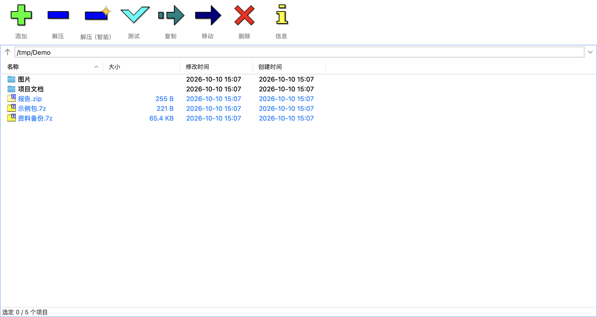
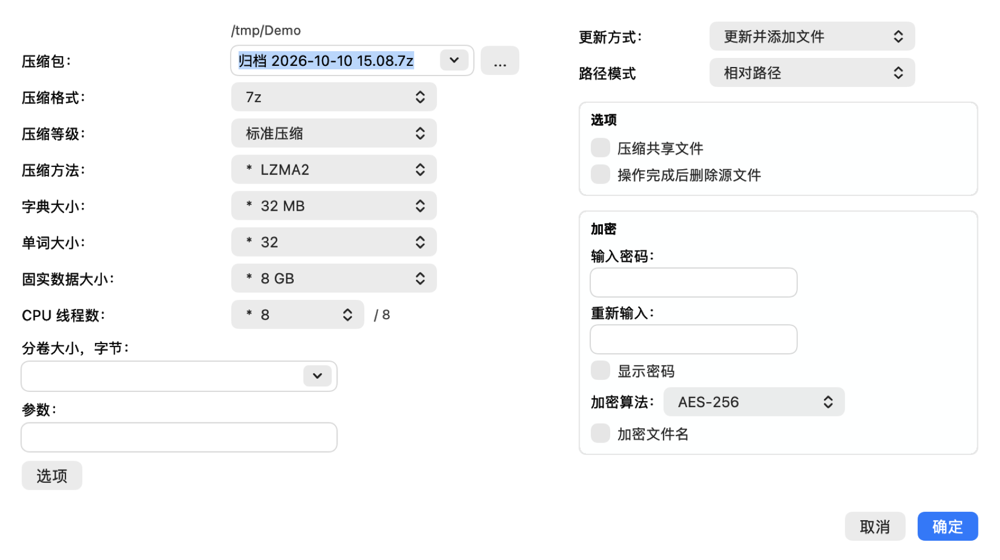

# 7-Zip for macOS

macOS 上的 7-Zip 图形前端，原生 AppKit，直接复用官方 `7zz` 引擎。

7-Zip 官方在 macOS 只提供命令行（`7zz`）。本项目为其实现原生 AppKit 界面，交互沿用  
Windows 版 7-Zip File Manager —— 工具栏布局、功能键（`F3` / `F4` 等）与之一致。  
「解压（智能）」为 macOS 侧新增命令，见下文。



## 功能

**格式**　7-Zip 引擎支持的全部格式：7z、zip、rar、tar、gz、bz2、xz、zst、iso、dmg、  
cab、rpm、deb、apk、ipa、msi、docx、xlsx 等。

**解压**　解压到当前文件夹 / 解压到指定目录 / 解压（智能，按包内结构决定是否套一层目录）；  
浏览归档时可单独提取其中条目。

**压缩**　支持 7z、zip、tar、xz、gzip、bzip2、wim 与校验值文件（hash）共 8 种格式；  
参数面板含压缩等级、压缩方法、字典大小、单词大小、固实块大小、线程数、分卷大小、  
AES-256 加密与文件名加密。从访达拖入文件或文件夹即弹出该面板。

**浏览**　双击进入归档内部，与普通目录同样进出 / 排序 / 查看属性；双面板对照操作；  
`F9` 切换单 / 双面板。

**文件操作与校验**　改名、复制、移动、删除、新建文件夹 / 文件、掩码选择；整包测试；  
CRC32、CRC64、SHA-1、SHA-256、BLAKE2sp 等校验值；文件比较；分割与合并。

**系统集成**　Finder 服务菜单 5 项（解压（智能）、解压到当前文件夹、解压到…、  
使用 7-Zip 压缩…、校验归档）；自访达拖入窗口即压缩，`⌘` 拖动则为复制；  
归档类型以备选身份注册，不占用现有默认程序关联。

## 截图

| 双面板 | 归档内部 |
| --- | ---- |
| 双面板 | 归档内部 |



## 系统要求

- macOS 13.0 或更高。
- Apple Silicon 与 Intel 均有原生切片（App 与引擎均为 universal 二进制），Intel 机器无需 Rosetta。

## 安装

1. 从 [Releases](https://github.com/Tom13908/7zip-macos/releases) 下载 26.03 的 DMG 并挂载。
2. 将 `7-Zip File Manager` 拖入 `Applications`。
3. 首次启动会被 Gatekeeper 拦截，处理方式见下。
4. 在系统设置中启用 Finder 服务项（见「Finder 服务菜单」）。

引擎随 App 分发（`Contents/Resources/7zz`），无需另行安装。

### 首次启动

App 未经 Apple 公证，首次打开会被 Gatekeeper 拦截。

- **macOS 15 及以上**：双击后系统提示无法验证开发者，关闭该提示；在  
  `系统设置 → 隐私与安全性` 的「安全性」一节点「仍要打开」并再次确认。
- **macOS 13 / 14**：右键图标 →「打开」，在弹窗中再次确认。

或直接移除隔离属性：

```
xattr -cr "/Applications/7-Zip File Manager.app"
```

### Finder 服务菜单

右键点归档或任意文件，菜单中应出现以下 5 项：

| 菜单项          | 出现条件        |
| ------------ | ----------- |
| 解压（智能）       | 选中归档时       |
| 解压到当前文件夹     | 选中归档时       |
| 解压到…         | 选中归档时       |
| 使用 7-Zip 压缩… | 选中任意文件或文件夹时 |
| 校验归档         | 选中归档时       |

服务项名称与顺序由系统决定：名称跟随**系统**语言（而非 App 内所选语言），同一 App 的  
服务排为一组、组内按本地化后的文字排序。未显示时，在  
`系统设置 → 键盘 → 键盘快捷键 → 服务 → 文件与文件夹` 中启用。

服务按 App 当前所在路径注册。系统中存在同一 App 的多份副本时（尤其是废纸篓中的旧副本），  
右键菜单可能调用错误的副本。变更位置后请重新注册：

```
LSR=/System/Library/Frameworks/CoreServices.framework/Frameworks/LaunchServices.framework/Support/lsregister
"$LSR" -f "/Applications/7-Zip File Manager.app"
```

## 使用

### 界面

顶部工具栏：添加 / 解压 / 解压（智能）/ 测试 / 复制 / 移动 / 删除 / 信息；其下为地址栏  
（左端向上箭头按钮，右端路径框），中间文件列表，底部状态栏。工具栏按钮恒可用，不随选中项  
置灰（与 Windows 版一致，启用状态仅作用于地址栏的向上箭头）。

- 双击目录进入；双击归档进入包内浏览，选中条目按「解压」解出。
- 列表内按住左键拖动为框选多选，任意行或空白处起拖均可。
- 按住 `⌥` 拖动为将文件拖出（至访达或另一面板）。
- 自访达拖入窗口即压缩（弹出与「使用 7-Zip 压缩…」相同的对话框）；按住 `⌘` 拖入则为  
  复制到该面板目录；拖入归档面板则为追加进包。
- `工具 → 选项` 中的开关与 Windows 版同名同义（新增「显示隐藏项目」见下）。
- `文件` 菜单中的命令随选中项置灰。

### 解压（智能）

可从访达右键、工具栏第三个按钮、列表右键三处调用。落点由包内顶层结构决定：

| 包内顶层   | 解压位置                          |
| ------ | ----------------------------- |
| 仅一个文件  | 归档所在目录，不建包装层                  |
| 仅一个文件夹 | 归档所在目录，该文件夹整体落地               |
| 多个顶层项  | 新建「归档名」文件夹装入；同名已存在时为「归档名 (2)」 |

与前两者的差异仅出现在第三种情形：「解压到当前文件夹」会将多个顶层项直接铺在归档所在目录。

无法读出包内结构时（如加密包未提供密码）按第三种处理，即多加一层目录。

### 覆盖与重名

解压前检测落点同名项，存在时提示 **覆盖 / 跳过 / 改名**，三条解压命令统一走此逻辑。

压缩时若目标归档已存在，提示 **并入现有归档 / 更换名称**。

多选压缩时默认名为「归档 2026-10-08 15.30.7z」（固定词「归档」+ 到分钟的时间戳，  
其他语言使用对应译法）；单选时仍为「原名.7z」。名称可在对话框中修改。

解压、压缩、复制等操作弹出进度窗口，**完成后自动关闭**，仅在出错时保留并列出错误。

### 启动位置

`工具 → 选项 → 启动时打开`：

- **上次打开的文件夹**（默认）。
- **主路径** —— 每次固定打开同一目录；默认用户主目录，可在同页 `主路径` 中修改或通过  
  `选择…` 指定，清空输入框则回到默认。

自访达双击归档进入时不受此设置影响，直接打开所点归档。

### 隐藏项

默认不显示隐藏项。`工具 → 选项 → 显示隐藏项目` 可切换。判定采用 macOS 口径：  
名称以 `.` 开头（`.DS_Store`、`.git`）或带 hidden 标志（如主目录下的 `Library`）。  
该设置仅作用于文件列表；归档内部按原样列出，不做过滤。

### 返回上一级

- 地址栏左端向上箭头按钮（同 `查看 → 向上一级`）。
- `⌫`（Backspace）。
- `⌃PageUp`。
- 列表内双击 `..` 行（需先在 `工具 → 选项` 中启用 `显示「..」项`，默认关闭，与 Windows 版一致）。

### 快捷键

| 键    | 作用  | 键          | 作用        |
| ---- | --- | ---------- | --------- |
| `F2` | 重命名 | `F7`       | 新建文件夹     |
| `F3` | 查看  | `Shift+F4` | 新建文件      |
| `F4` | 编辑  | `F9`       | 双面板 / 单面板 |
| `F5` | 复制到 | `⌫`        | 返回上一级     |
| `F6` | 移动到 | `⌘⌫`       | 删除        |

采用 Windows 功能键布局；在将 `F1`–`F12` 作为媒体键的 Mac 上需配合 `Fn` 按下。  
另有 macOS 惯用键：`⌘A` 全选、`⌘I` 属性、`⌘,` 选项、`⌘Q` 退出。

## 语言

界面语言跟随系统语言，支持：

|               |                    |          |
| ------------- | ------------------ | -------- |
| 简体中文（zh-Hans） | 繁體中文（zh-Hant）      | 日本語      |
| 한국어           | Deutsch            | Français |
| Español       | Português (Brasil) | Italiano |
| Русский       | English（源语言）       |          |

于 `系统设置 → 通用 → 语言与地区` 修改，重启 App 生效。界面与 Finder 服务菜单始终使用  
同一语言，不会出现界面中文、菜单英文的错位。

## 卸载

将 App 移入废纸篓，并删除 `~/Library/Preferences/org.7-zip.FileManager.plist`。  
LaunchServices 会保留指向已删除路径的注册记录，可按路径注销：

```
LSR=/System/Library/Frameworks/CoreServices.framework/Frameworks/LaunchServices.framework/Support/lsregister
"$LSR" -u "/Applications/7-Zip File Manager.app"
```

## 技术栈

**界面**　Swift + AppKit，不使用 SwiftUI，无第三方依赖；图标取自 7-Zip 官方素材，  
与 Windows 版同源。

**引擎**　7-Zip 26.03 官方源码，经 `scripts/build-engine.sh` 编译为 `7zz`，编解码代码未作修改。  
所有压缩解压由该子进程完成，界面仅解析其输出。

**二进制**　App 与 `7zz` 均为 universal（arm64 + x86_64）；两个切片的部署目标与  
`Info.plist` 一致，均为 macOS 13.0。

**本地化**　11 种语言文案与 7-Zip 官方语言包逐条对齐：可对应者直接取自官方  
[7-zip.org](https://www.7-zip.org) 安装程序中的 `Lang/*.txt`，官方未覆盖的 macOS 侧文案  
（服务菜单名、AppKit 惯例项、启动位置等设置项）按同样用词补齐。翻译文件位于  
`resources/l10n/<语言>.strings`，键为英文原文。

## 实现说明

界面、本地化与构建脚本通过**DeepSeek-V4.1-Flash** 完成；引擎 `7zz` 为  
7-Zip 官方源码原样编译，未经修改。

## 致谢

界面图标、文案原文（`en.ttt`）与各语言译文来自 7-Zip 官方，引擎由官方 26.03 源码编译。  
本仓库沿用 7-Zip 原版许可（GNU LGPL 2.1+，RAR 解压部分另带 unRAR restriction），全文见 [LICENSE](LICENSE)。  
7-Zip 版权归 Igor Pavlov 所有。
